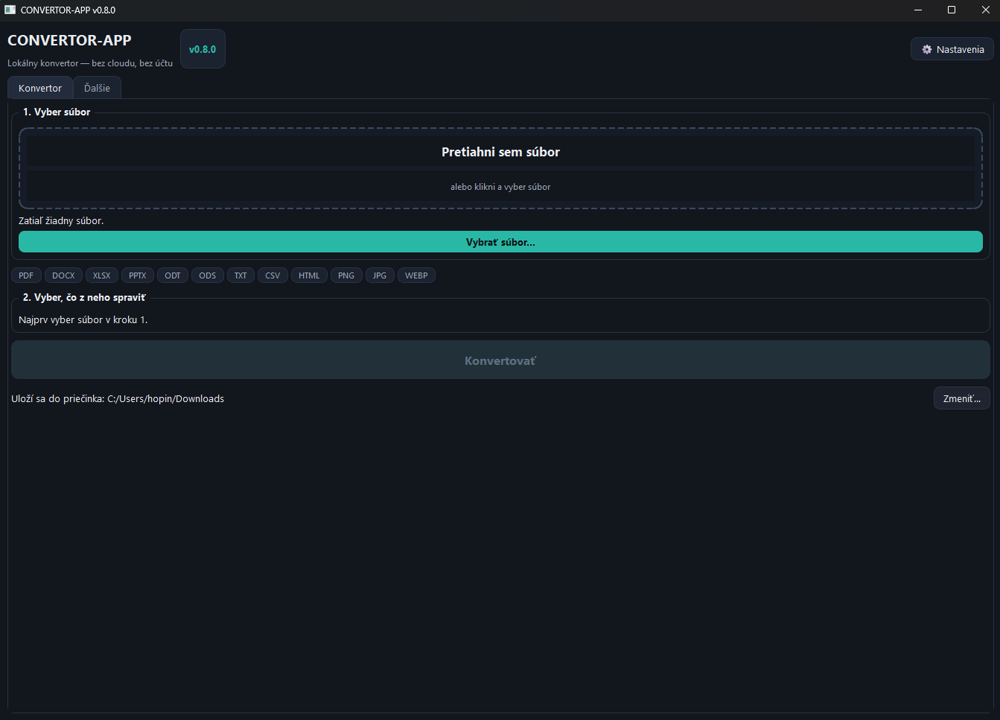
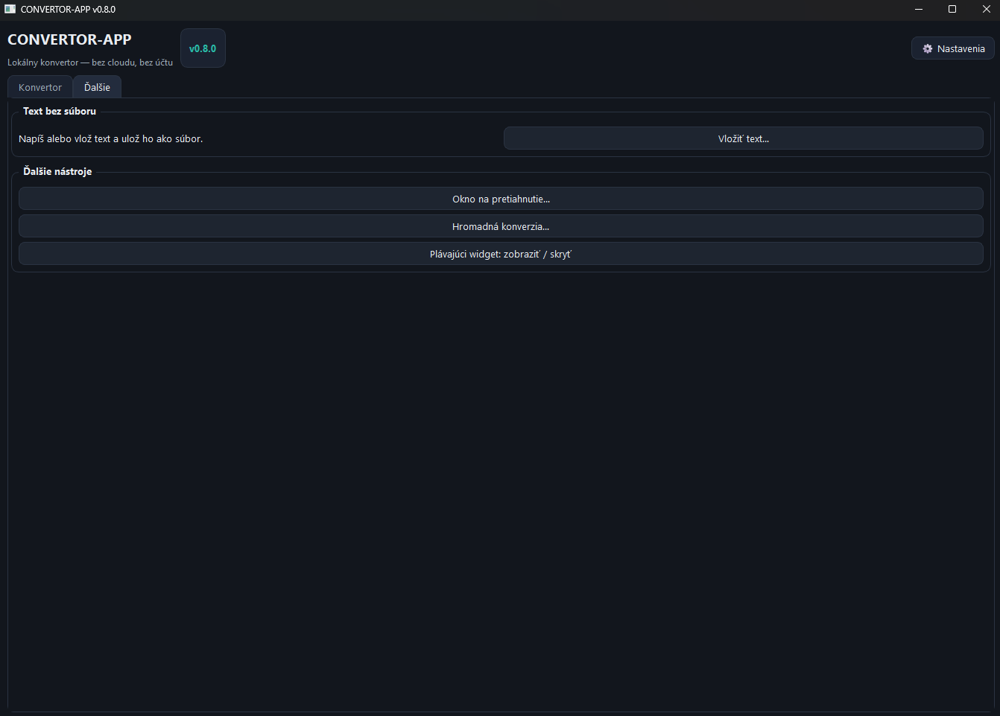
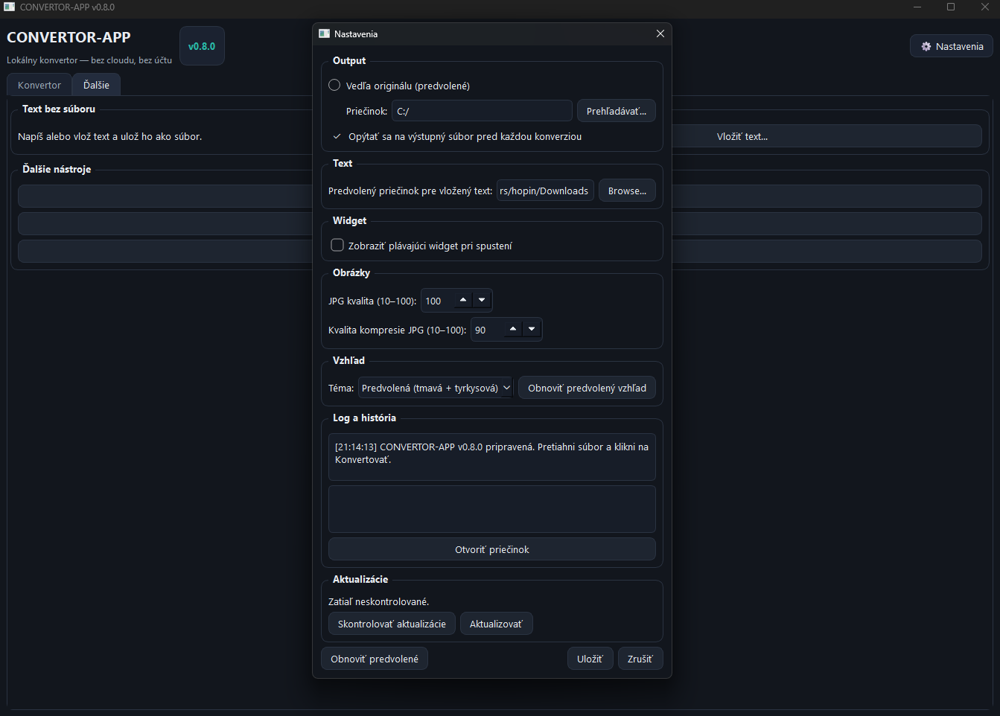

# CONVERTOR-APP — v0.8.0

Local desktop file converter for Windows. Pick a file, get only the conversions that fit it, and save a new file — the original is never overwritten.

No upload, no account, no keys, no telemetry. Everything runs locally.







## Stiahnutie (Windows)

Najjednoduchšie: stiahni **CONVERTOR-APP.exe** z [Releases](https://github.com/Battingchart300/CONVERTOR-APP/releases) a dvakrát naň klikni. Nič sa neinštaluje, Python netreba, žiadny .zip.

> Pri prvom spustení môže Windows ukázať varovanie SmartScreen, pretože .exe nie je digitálne podpísaný. Klikni na „Ďalšie informácie" → „Spustiť aj tak". Súbor sa stavia automaticky z tohto repozitára cez GitHub Actions, nič iné v ňom nie je.

> Prečo má .exe ~130 MB? Obsahuje v sebe celý Python aj všetky knižnice (PySide6, Pillow, PyMuPDF, python-docx, reportlab, Markdown) — preto netreba nič inštalovať ani mať Python. Samotný kód appky má len ~0,4 MB.

## What it does

| Input | Output |
|---|---|
| Image (PNG / JPG / WEBP) | PNG, JPG, WEBP, compress, strip metadata (EXIF/GPS), white background, image → PDF |
| PDF | → Markdown (text, one section per page) |
| Word (.docx) | → Markdown, → PDF |
| Excel (.xlsx) | → Markdown, → CSV (first sheet), → PDF |
| PowerPoint (.pptx) | → Markdown, → PDF (slide text only) |
| Text / CSV / HTML | → Markdown, → PDF |
| LibreOffice (.odt / .ods / .odp) | → Markdown, → PDF / CSV |
| Pasted text | Save as .md / .txt / .pdf, or copy to clipboard |

Plus: batch conversion (many files, grouped by type), session history, configurable output folder, and an update check that restarts the app itself after a successful update (v0.5.2).

## Three ways to use it

1. **Main window** — stiahni .exe z Releases a dvakrát klikni, alebo zo zdrojového kódu `.\run.ps1` (skontroluje knižnice a spustí appku) či priamo `python main.py`. Jednoduchá tmavá GUI v troch krokoch: vyber súbor, vyber, čo z neho spraviť, klikni na Konvertovať — výsledok sa ukáže rovno pod tlačidlom.
2. **Drop window** — drop a file, the app asks what to do with it and shows only fitting actions.
3. **Floating widget** — small always-on-top widget. Drag a file onto it and a ring of actions opens around it.

## Spustenie zo zdrojového kódu (pre vývojárov)

```powershell
.\run.ps1
```
`run.ps1` skontroluje Python a potrebné knižnice, chýbajúce ponúkne nainštalovať (Y/N) a potom spustí appku. Priamo bez kontroly: `python main.py`.

Pretiahni súbor (alebo ho vyber), vyber, čo z neho spraviť, klikni na Konvertovať — nový súbor sa uloží vedľa pôvodného a výsledok uvidíš rovno v okne.

Settings live outside the repo in `~/.convertor-app/settings.json`, so `git pull` never overwrites them.

## Tech

Python + PySide6, Pillow, PyMuPDF, python-docx, reportlab, Markdown. OpenDocument support uses stdlib only (`zipfile` + XML) — no extra dependency.

## Project structure

```
main.py               entry point -> main GUI window
requirements.txt      PySide6 + Pillow + Markdown + PyMuPDF + python-docx + reportlab
beaver/
  actions.py          pure actions (no Qt, testable alone)
  gui.py              main window, Drop window, Settings, batch, update
  widget.py           floating widget + ring menu
  settings.py         user settings (stdlib only, safe fallback)
  update_check.py     update check + auto-restart after update
```

## Honest limitations

- Document → PDF keeps text, headings and simple lists. Images, complex tables and exact layout are **not** preserved — this is a text converter, not a layout clone.
- Formulas are read as their stored (cached) value, not recalculated. XLSX / ODS → CSV is the first sheet only.
- Scanned / image-only PDFs have no extractable text, so PDF → Markdown on those yields (nearly) empty output.
- The Windows GUI v0.8.0 was run on Windows and confirmed 16.11.2026 — the screenshots above are from v0.8.0 (main window, Ďalšie tab, Settings with themes and Log a história). The .exe is built by GitHub Actions after the v0.8.0 tag is pushed. See [CHANGELOG.md](CHANGELOG.md) for the full version history and test notes.

## License

MIT — see [LICENSE](LICENSE).
